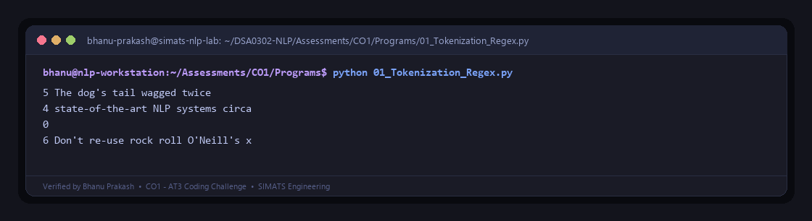
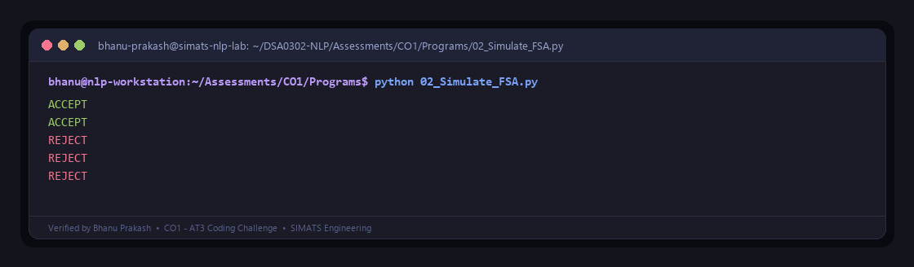
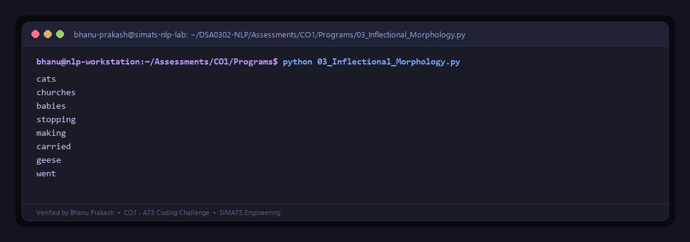
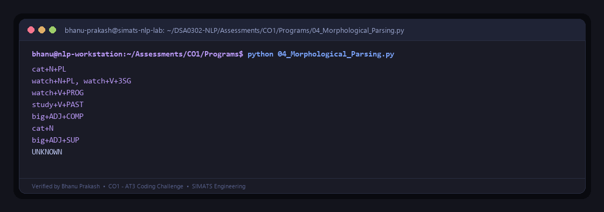
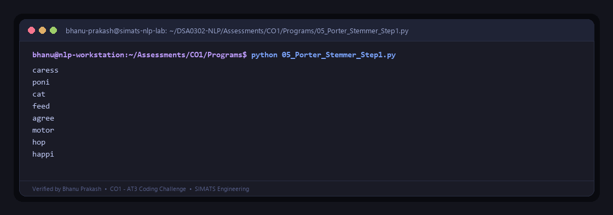

# CO1 - AT3 (Coding Challenge) — Execution Outputs & Screenshots Gallery

**Course:** `DSA0302` — Natural Language Processing  
**Author:** Ravilla Bhanu Prakash  
**Institution:** SIMATS Engineering  
**Theme:** Tokyo Night Terminal Visuals  

---

This directory contains the verified console execution logs and high-resolution **Tokyo Night** dark-mode terminal window screenshots for the **CO1 - AT3 Coding Challenge** assessment problems.

---

### Problem 01: Tokenization using Regular Expressions
- **Jupyter Notebook:** [`Programs/01_Tokenization_Regex.ipynb`](../Programs/01_Tokenization_Regex.ipynb)
- **Python Script:** [`Programs/01_Tokenization_Regex.py`](../Programs/01_Tokenization_Regex.py)
- **Sample Input File:** [`Programs/sample_inputs/P01_Input.txt`](../Programs/sample_inputs/P01_Input.txt)
- **Raw Execution Log:** [`P01_Output.txt`](./P01_Output.txt)
- **Terminal Output Screenshot:**

---

### Problem 02: Simulate Finite State Automaton (FSA)
- **Jupyter Notebook:** [`Programs/02_Simulate_FSA.ipynb`](../Programs/02_Simulate_FSA.ipynb)
- **Python Script:** [`Programs/02_Simulate_FSA.py`](../Programs/02_Simulate_FSA.py)
- **Sample Input File:** [`Programs/sample_inputs/P02_Input.txt`](../Programs/sample_inputs/P02_Input.txt)
- **Raw Execution Log:** [`P02_Output.txt`](./P02_Output.txt)
- **Terminal Output Screenshot:**

---

### Problem 03: Inflectional Morphology Generator
- **Jupyter Notebook:** [`Programs/03_Inflectional_Morphology.ipynb`](../Programs/03_Inflectional_Morphology.ipynb)
- **Python Script:** [`Programs/03_Inflectional_Morphology.py`](../Programs/03_Inflectional_Morphology.py)
- **Sample Input File:** [`Programs/sample_inputs/P03_Input.txt`](../Programs/sample_inputs/P03_Input.txt)
- **Raw Execution Log:** [`P03_Output.txt`](./P03_Output.txt)
- **Terminal Output Screenshot:**

---

### Problem 04: Morphological Surface Parsing
- **Jupyter Notebook:** [`Programs/04_Morphological_Parsing.ipynb`](../Programs/04_Morphological_Parsing.ipynb)
- **Python Script:** [`Programs/04_Morphological_Parsing.py`](../Programs/04_Morphological_Parsing.py)
- **Sample Input File:** [`Programs/sample_inputs/P04_Input.txt`](../Programs/sample_inputs/P04_Input.txt)
- **Raw Execution Log:** [`P04_Output.txt`](./P04_Output.txt)
- **Terminal Output Screenshot:**

---

### Problem 05: Porter Stemmer (Step 1 Implementation)
- **Jupyter Notebook:** [`Programs/05_Porter_Stemmer_Step1.ipynb`](../Programs/05_Porter_Stemmer_Step1.ipynb)
- **Python Script:** [`Programs/05_Porter_Stemmer_Step1.py`](../Programs/05_Porter_Stemmer_Step1.py)
- **Sample Input File:** [`Programs/sample_inputs/P05_Input.txt`](../Programs/sample_inputs/P05_Input.txt)
- **Raw Execution Log:** [`P05_Output.txt`](./P05_Output.txt)
- **Terminal Output Screenshot:**

